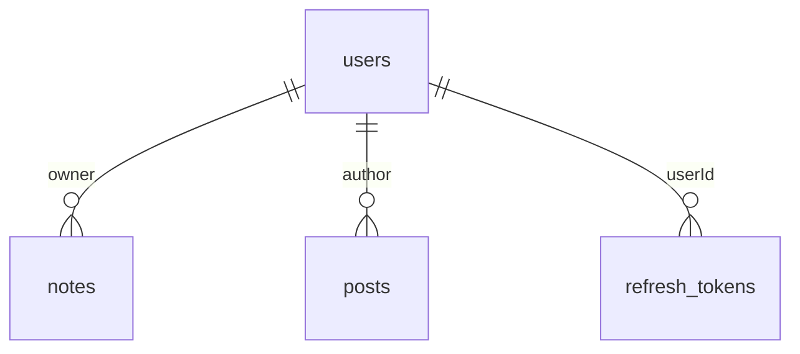

# Database Schema

MongoDB (Atlas), with Mongoose. The schemas are in `src/infra/mongo/schemas/`. Every index is defined with `schema.index`, in the same file as its schema.

## Collections

### `users`

| Field          | Type       | Notes                                               |
| -------------- | ---------- | --------------------------------------------------- |
| `_id`          | `ObjectId` | Primary key                                         |
| `email`        | `string`   | Required, lower case, unique                        |
| `passwordHash` | `string`   | Required, argon2 hash. Hidden from queries          |
| `role`         | `string`   | `USER` (default) or `ADMIN`                         |
| `interests`    | `string[]` | Default empty. Grouped by the interests aggregation |
| `createdAt`    | `Date`     | Set by Mongoose                                     |
| `updatedAt`    | `Date`     | Set by Mongoose                                     |

### `refresh_tokens`

One document per session.

| Field       | Type       | Notes                                                  |
| ----------- | ---------- | ------------------------------------------------------ |
| `_id`       | `string`   | The session id. It goes inside the refresh token       |
| `userId`    | `ObjectId` | Required, the user the session belongs to              |
| `tokenHash` | `string`   | Required, SHA-256 hash of the token. Never the token   |
| `expiresAt` | `Date`     | Required. MongoDB deletes the document after this time |
| `createdAt` | `Date`     | Set by Mongoose                                        |

### `notes`

| Field       | Type       | Notes               |
| ----------- | ---------- | ------------------- |
| `_id`       | `ObjectId` | Primary key         |
| `owner`     | `ObjectId` | Required, the user  |
| `title`     | `string`   | Required, max 200   |
| `content`   | `string`   | Required, max 10000 |
| `createdAt` | `Date`     | Set by Mongoose     |
| `updatedAt` | `Date`     | Set by Mongoose     |

### `posts`

| Field       | Type       | Notes               |
| ----------- | ---------- | ------------------- |
| `_id`       | `ObjectId` | Primary key         |
| `author`    | `ObjectId` | Required, the user  |
| `title`     | `string`   | Required, max 200   |
| `content`   | `string`   | Required, max 10000 |
| `createdAt` | `Date`     | Set by Mongoose     |
| `updatedAt` | `Date`     | Set by Mongoose     |

## Indexes

Only indexes that a query needs exist. Besides these, every collection has the default `_id` index.

| Collection       | Index                       | Used by                                                                                      |
| ---------------- | --------------------------- | -------------------------------------------------------------------------------------------- |
| `users`          | `{ email: 1 }`, unique      | Login by email and the duplicate email check on register and update                          |
| `refresh_tokens` | `{ expiresAt: 1 }`, TTL 0 s | Removes expired sessions                                                                     |
| `notes`          | `{ owner: 1, _id: -1 }`     | A user's notes, newest first, and the owner check on one note                                |
| `posts`          | `{ author: 1, _id: -1 }`    | The posts of one author, newest first, and the `$lookup` from users in the posts aggregation |

### Queries that need no extra index

- **Get by id** (a user, a note, a post, a session): the default `_id` index.
- **End all sessions of a user** (`deleteMany({ userId })`): rare, and the TTL index keeps `refresh_tokens` small, so a scan is cheap. An index on `userId` would slow every login for little gain.
- **Admin: list all users** and **list all notes**, **list all posts**: sorted by `_id`, which is the default index. Pagination uses `_id` as the cursor.
- **Users grouped by interests**: one aggregation over the whole `users` collection (`$unwind` and `$group`). It reads every user, so an index would not help. This is checked again with `explain()` in the index review.
